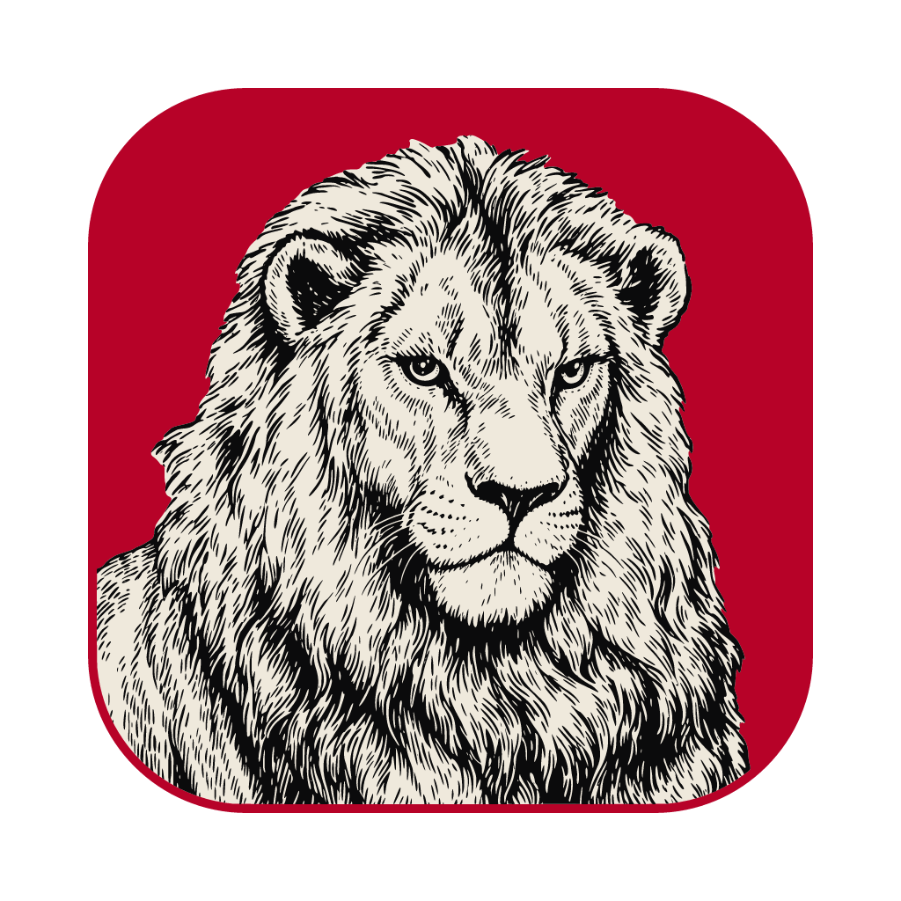

<p align="center">
  
</p>

<h1 align="center">PdfCraft for Android</h1>

<p align="center">
  <b>PdfCraft-android is an open-source reimplementation of the Adobe Acrobat Reader Android app, created using the same Rust engine, <a href="https://github.com/storytold/pdfcraft">PdfCraft</a>, as the desktop app, and built with a Kotlin/Jetpack Compose UI framework.</b><br>
  Many credits to the original maintainers, <a href="https://github.com/storytold">storytold</a>.
</p>

<p align="center">
  <a href="https://github.com/artcraft-android/pdfcraft-android/releases"></a>
  <a href="https://apps.obtainium.imranr.dev/redirect?r=obtainium://add/https://github.com/artcraft-android/pdfcraft-android"></a>
  <br><sub>Each release has two APKs: the plain one for most phones, the <code>-armeabi-v7a</code> one for 32-bit ARM phones.</sub>
</p>

<p align="center">
  
  
  
  
  
  
</p>

<p align="center">
  <a href="#reading">Reading</a> ·
  <a href="#navigate-long-documents">Navigate</a> ·
  <a href="#comments">Comments</a> ·
  <a href="#forms--fill--sign">Forms &amp; Fill &amp; Sign</a> ·
  <a href="#edit-pdf">Edit PDF</a> ·
  <a href="#read-aloud">Read aloud</a> ·
  <a href="#tools">Tools</a> ·
  <a href="#home">Home</a> ·
  <a href="#light-theme">Light theme</a> ·
  <a href="#architecture">Architecture</a> ·
  <a href="#planned-features">Planned features</a> ·
  <a href="#building-instructions">Building</a>
</p>

<br>

<p align="center">
  
  <br>
  <sub>The PdfCraft Showcase, a 13-page specimen PDF, open on its cover.</sub>
</p>

<br>

## Reading

<p align="center">
  
  <br>
  <sub>Twelve writing systems, vertical Japanese and colour emoji, with the bars hidden by a tap.</sub>
</p>

<br>

<table align="center">
<tr>
<td align="center"></td>
<td align="center"></td>
</tr>
<tr>
<td align="center"><sub>Reading Mode: text reflowed to the screen</sub></td>
<td align="center"><sub>Night Mode, from View settings</sub></td>
</tr>
</table>

<br>

## Navigate long documents

<table align="center">
<tr>
<td align="center"></td>
<td align="center"></td>
</tr>
<tr>
<td align="center"><sub>Pages: every page at a glance</sub></td>
<td align="center"><sub>The outline, and bookmarks of your own</sub></td>
</tr>
</table>

<br>

## Comments

<table align="center">
<tr>
<td align="center"></td>
<td align="center"></td>
</tr>
<tr>
<td align="center"><sub>A comment's thread, ‹ 3 of 17 › and Reply</sub></td>
<td align="center"><sub>The Comment List, by page</sub></td>
</tr>
</table>

<br>

## Forms & Fill & Sign

<table align="center">
<tr>
<td align="center"></td>
<td align="center"></td>
</tr>
<tr>
<td align="center"><sub>Every fillable field tinted blue</sub></td>
<td align="center"><sub>Fill & Sign: a signature placed with a tap</sub></td>
</tr>
</table>

<br>

## Edit PDF

<p align="center">
  
  <br>
  <sub>Edit PDF: tap a paragraph to edit its text, change its style, move it or rewrap it.</sub>
</p>

<br>

## Read aloud

<table align="center">
<tr>
<td align="center"></td>
<td align="center"></td>
</tr>
<tr>
<td align="center"><sub>Read aloud, the words marked as they're read</sub></td>
<td align="center"><sub>The full player: time left, Voice and speed</sub></td>
</tr>
</table>

<br>

## Tools

<table align="center">
<tr>
<td align="center"></td>
<td align="center"></td>
</tr>
<tr>
<td align="center"><sub>More tools, and Customize toolbar</sub></td>
<td align="center"><sub>Compress PDF, one of the tools that make a new file</sub></td>
</tr>
</table>

<br>

## Home

<table align="center">
<tr>
<td align="center"></td>
<td align="center"></td>
</tr>
<tr>
<td align="center"><sub>Home: the tools, Recent, Starred and On device</sub></td>
<td align="center"><sub>The Tools tab: every tool, by what it does</sub></td>
</tr>
</table>

<br>

## Light theme

<table align="center">
<tr>
<td align="center"></td>
<td align="center"></td>
</tr>
<tr>
<td align="center"><sub>The viewer in the light theme</sub></td>
<td align="center"><sub>Home in the light theme</sub></td>
</tr>
</table>

<br>

## Architecture

<p align="center">
  
  <br>
  <sub>How the app and the engine fit together. Generated with <a href="https://gitdiagram.com/artcraft-android/pdfcraft-android">GitDiagram</a>.</sub>
</p>

<br>

## Planned features

PdfCraft for Android is in beta.

| Area | Status |
|---|---|
| Open PDFs from files, other apps and Recent; Starred, On device, Files and Search | ✅ |
| Reading: continuous and single page, Reading Mode, Night Mode, find, text selection, links, bookmarks and contents, attachments | ✅ |
| Read aloud with the phone's voice, the words marked as they're read, and a full player | ✅ |
| Comments: notes, voice comments, highlight, underline, strikethrough, drawing (snap to shape), text; the Comment List and threads | ✅ |
| Forms, and Fill & Sign: text, marks and a drawn or imported signature | ✅ |
| Digital signatures: sign with a digital ID (a .p12 / .pfx file, or one made in the app), check a document's signatures, trust signers | ✅ |
| Edit PDF: edit text, add text and images, move, resize and turn pictures | ✅ · cropping a picture ⬜ |
| Organize and crop pages | ✅ |
| Compress, combine, set password, create PDF (images, text, office documents), scan | ✅ |
| Export to Word, RTF, Excel, PowerPoint, JPEG and PNG | ✅ · Word 97 ⬜ |
| Recognize text | ✅ (the Latin alphabet without accents) |
| A customizable quick toolbar, upright and sideways layouts, light and dark themes | ✅ |
| Translations: all of the app's text is ready to translate ([how](#translating)) | ✅ · languages besides English ⬜ |
| AI assistant, cloud storage, sharing for review | 🚫 PdfCraft is a local app |

<sub>✅ works today · 🚧 in progress · ⬜ not started · 🚫 not planned</sub>

<br>

## Building Instructions
*One Gradle command builds the whole app: it compiles the Rust engine with [cargo-ndk](https://github.com/bbqsrc/cargo-ndk) and generates the Kotlin bindings.*

* Clone this repository
* Make sure you have at least 3 GB of free disk space
* Recognize text's models (12 MB, CC-BY-SA-4.0) are in `assets/models/`; `apps/pdfcraft-android/fetch-models.sh` downloads them again if you need to
* enter `apps/pdfcraft-android/android` and run `./gradlew assembleRelease`, or open that folder in Android Studio and press Run.

Build time dependencies:

<details>
  <summary>required tools</summary>

  ```
      rustup (it installs the Rust release and Android targets rust-toolchain.toml names)
      cargo install cargo-ndk --version 4.1.2 --locked
      Android SDK (API 37) and NDK 29.0.14206865
      JDK 17 or newer
  ```
</details>

*Builds are only tested on Windows 11.*

<br>

## Translating

All of PdfCraft's text is in one file:
[`apps/pdfcraft-android/android/app/src/main/res/values/strings.xml`](apps/pdfcraft-android/android/app/src/main/res/values/strings.xml).
To add a language:

* copy it to a `values-<language>` folder beside it: `values-es/strings.xml` for Spanish, `values-pt-rBR/strings.xml` for Brazilian Portuguese
* translate the text between the tags; keep each `name`, the placeholders (`%1$s`, `%2$d`, which you may move) and escapes such as `\'`
* leave out anything you haven't translated yet: it shows in English
* open a pull request

The store listing is in `fastlane/metadata/android/en-US/`; a copy in a folder for your language (`es-ES`, `pt-BR`)
translates it too. On Android 13 and newer, PdfCraft's language can be set on its own under Settings ▸ Apps ▸
PdfCraft ▸ Language. A few messages from the PDF engine, such as some errors and the names in Undo, are English
for now.

<br>

## License

[MIT](LICENSE-MIT) OR [Apache-2.0](LICENSE-APACHE), at your option. PdfCraft for Android is not affiliated with Adobe;
Acrobat is a trademark of Adobe Inc.

<br>

## Misc info for myself

Try to use [semantic commit](https://kapeli.com/cheat_sheets/Semantic_Commits.docset/Contents/Resources/Documents/index)
messages. Use `feat:` / `fix:` / `chore:` / `docs:` / etc.
